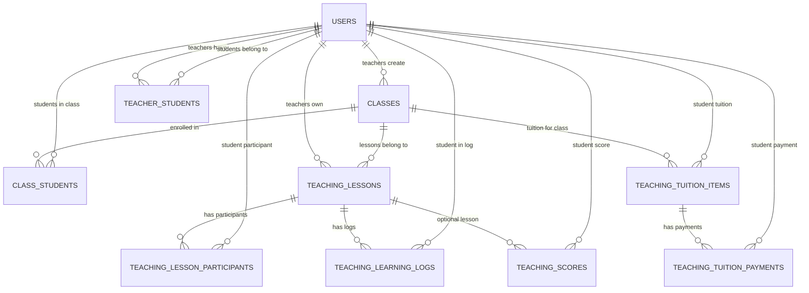
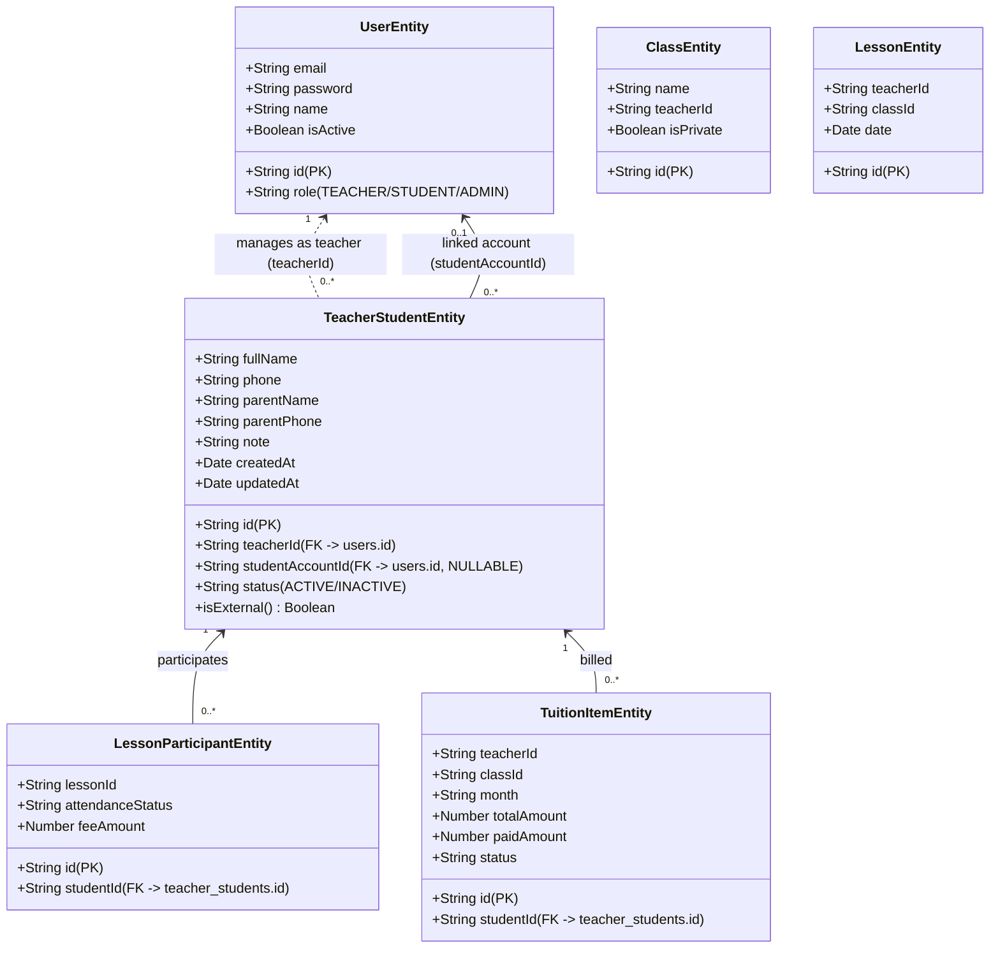

# DOMAIN IMPACT AUDIT: EXTERNAL STUDENT MANAGEMENT
**Hệ thống Giáo dục QuizMaster**
**Branch:** `fix/external-student-management`
**Ngày thực hiện:** 19/10/2026

---

## 1. TỔNG QUAN VẤN ĐỀ NGHIỆP VỤ (EXECUTIVE SUMMARY)

Hiện tại, QuizMaster được thiết kế theo giả định: **Mọi học sinh mà giáo viên quản lý đều phải là một tài khoản người dùng (`User` với `role = 'STUDENT'`) đã đăng ký trong hệ thống.**

Ràng buộc này dẫn tới các hạn chế nghiêm trọng trong thực tế giảng dạy:
1. **Rào cản gia nhập:** Giáo viên không thể dùng QuizMaster để quản lý lịch dạy, điểm danh, nhận xét buổi học, học phí hay bảng điểm cho các học sinh học trực tiếp hoặc học thêm bên ngoài nếu các em chưa/không có tài khoản.
2. **Quy trình mời cứng nhắc:** Giáo viên gửi lời mời qua email (`POST /students/invite`), hệ thống yêu cầu email học sinh phải tồn tại trước trong bảng `users`, nếu không sẽ báo lỗi `BadRequestException`.
3. **Tạo tài khoản giả (Anti-pattern):** Trong chức năng import học sinh từ Excel vào lớp (`POST /classrooms/:id/students/import`), nếu email chưa có trong hệ thống, code tự động tạo một `User` với password mặc định `123456`. Điều này vi phạm nghiêm trọng an toàn thông tin và tạo ra tài khoản "rác".

**Mục tiêu giải pháp:**
Tách bạch hoàn toàn giữa **"TeacherStudent" (Hồ sơ học sinh do Giáo viên quản lý)** và **"User Account" (Tài khoản người dùng trong hệ thống QuizMaster)**.
- Học sinh ngoài hệ thống (`studentAccountId = NULL`): Giáo viên quản lý toàn diện lịch dạy, điểm danh, nhật ký học tập, điểm số, học phí.
- Học sinh có tài khoản (`studentAccountId != NULL`): Giáo viên quản lý như trên + học sinh có thể đăng nhập, xem thông tin và làm bài tập.
- Tính năng liên kết tài khoản (Account Linking): Cho phép gắn tài khoản QuizMaster vào hồ sơ `TeacherStudent` đã có mà không làm mất hoặc trùng lặp bất kỳ dữ liệu lịch sử nào.

---

## A. CURRENT DOMAIN MODEL

### Hiện trạng cấu trúc thực thể


---

## B. CURRENT STUDENT / USER RELATIONSHIP

1. **Thực thể User (`backend/src/entities/user.entity.ts`):**
   - Đảm nhiệm 2 vai trò cùng lúc: Authentication Principal (`email`, `password`, `role`) và Student Profile (`name`, `dob`, `phone`, `school`).
   - Mối quan hệ giáo viên - học sinh được lưu qua bảng join `teacher_students` với 2 cột: `teacherId` (FK `users.id`) và `studentId` (FK `users.id`).
2. **Quy trình mời (`backend/src/modules/students/students.service.ts`):**
   - API `POST /students/invite` kiểm tra:
     ```typescript
     const student = await this.userRepo.findOneBy({ email });
     if (!student) throw new BadRequestException('Học sinh cần đăng ký tài khoản trước.');
     ```
   - Chỉ khi học sinh đã có tài khoản và chấp nhận lời mời (`POST /students/accept-invite`) thì cặp `(teacherId, studentId)` mới được ghi vào `teacher_students`.
3. **Hạn chế:** Không có cơ chế lưu trữ hồ sơ học sinh nếu người đó chưa đăng ký tài khoản `User`.

---

## C. CURRENT CLASS RELATIONSHIP

1. **Thực thể Class (`backend/src/entities/class.entity.ts`):**
   - Có quan hệ ManyToMany với `UserEntity` qua bảng join `class_students`:
     ```typescript
     @ManyToMany(() => UserEntity, user => user.classes)
     @JoinTable({
       name: 'class_students',
       joinColumn: { name: 'classId', referencedColumnName: 'id' },
       inverseJoinColumn: { name: 'studentId', referencedColumnName: 'id' }
     })
     students: IUserEntity[];
     ```
2. **Lớp kèm 1-1 (`private-${studentId}`):**
   - Trong `classrooms.service.ts`, hệ thống tự sinh lớp học ảo hoặc lưu vào bảng `classes` với ID quy ước `private-${studentId}`, tên `Kèm 1-1: ${student.name}`, `isPrivate: true`.
   - `studentId` ở đây bắt buộc là `UserEntity.id`.
3. **Import học sinh từ Excel (`classrooms.service.ts: importStudents`):**
   - Nếu học sinh trong file chưa có tài khoản, code tạo mới một `UserEntity` với mật khẩu băm của `'123456'`, `role: 'STUDENT'`. Điều này tạo tài khoản giả trong DB.

---

## D. CURRENT SCHEDULE RELATIONSHIP

1. **Thực thể Lesson (`backend/src/modules/teaching/entities/lesson.entity.ts`):**
   - Quản lý buổi học: `teacherId`, `classId`, `title`, `date`, `startTime`, `endTime`, `feePerLesson`, `status`.
2. **Thực thể Participant (`backend/src/modules/teaching/entities/lesson-participant.entity.ts`):**
   - Bảng `teaching_lesson_participants`:
     ```typescript
     @Column({ type: 'varchar', length: 64 })
     studentId: string;
     
     @ManyToOne(() => UserEntity, { onDelete: 'CASCADE' })
     @JoinColumn({ name: 'studentId' })
     student: IUserEntity;
     ```
   - Ràng buộc: `studentId` trỏ trực tiếp đến `users.id`. Nếu đưa vào một ID không có trong `users`, MySQL Foreign Key sẽ chặn ngay lập tức.
3. **ScheduleService (`schedule.service.ts`):**
   - Khi tạo buổi học (`createLesson`), danh sách học sinh được lấy từ `classEntity.students` (kiểu `UserEntity[]`).
   - Tạo các bản ghi `LessonParticipantEntity` gán `studentId: st.id`.

---

## E. CURRENT TUITION RELATIONSHIP

1. **Thực thể TuitionItem (`tuition-item.entity.ts`):**
   - Bảng `teaching_tuition_items`:
     - Ràng buộc duy nhất: `@Index(['classId', 'studentId', 'month'], { unique: true })`.
     - Foreign key: `@ManyToOne(() => UserEntity) @JoinColumn({ name: 'studentId' }) student: IUserEntity`.
2. **Thực thể TuitionPayment (`tuition-payment.entity.ts`):**
   - Bảng `teaching_tuition_payments`:
     - Lưu `tuitionItemId`, `teacherId`, `studentId`, `amount`, `paymentMethod`, `status`.
     - Foreign key: `@ManyToOne(() => UserEntity) @JoinColumn({ name: 'studentId' })`.
3. **Đồng bộ học phí (`tuition.service.ts: syncTuitionData`):**
   - Quét qua `teaching_lesson_participants` để tính tổng học phí theo key `${lesson.classId}__${p.studentId}`.
   - Khi hiển thị (`getTuitionList`), join với `UserEntity` để lấy `student.name`, `student.email`, `student.avatar`.

---

## F. CURRENT LEARNING LOG RELATIONSHIP

1. **Thực thể LearningLog (`learning-log.entity.ts`):**
   - Bảng `teaching_learning_logs`:
     - Lưu `teacherId`, `classId`, `lessonId`, `studentId`, `content`, `homework`, `attitude`, `comment`, `note`.
     - Foreign key: `@ManyToOne(() => UserEntity) @JoinColumn({ name: 'studentId' })`.
2. **LearningLogsService (`learning-logs.service.ts`):**
   - Phương thức `createOrUpdateLog` kiểm tra nghiêm ngặt:
     ```typescript
     const student = await this.userRepo.findOne({ where: { id: dto.studentId } });
     if (!student) throw new NotFoundException('Không tìm thấy học sinh');
     ```
   - Chặn đứng mọi thao tác nếu `studentId` không phải là một user ID hợp lệ trong bảng `users`.

---

## G. CURRENT SCORE RELATIONSHIP

1. **Thực thể ScoreRecord (`score-record.entity.ts`):**
   - Bảng `teaching_scores`:
     - Lưu `teacherId`, `classId`, `studentId`, `lessonId`, `assessmentType`, `assessmentName`, `score`, `maxScore`, `date`, `comment`.
     - Foreign key: `@ManyToOne(() => UserEntity) @JoinColumn({ name: 'studentId' })`.
2. **ScoresService (`scores.service.ts`):**
   - Kiểm tra học sinh có thuộc lớp không qua `classEntity.students.some(s => s.id === dto.studentId)`.
   - Nếu `studentId` không tồn tại trong danh sách `UserEntity` của lớp sẽ trả về `BadRequestException`.

---

## H. CURRENT ATTENDANCE RELATIONSHIP

- Điểm danh hiện được gắn liền với `LessonParticipantEntity`:
  - Trạng thái `attendanceStatus`: `'ATTENDED' | 'ABSENT' | 'EXCUSED'`.
  - Phụ thuộc trực tiếp vào `UserEntity` do `studentId` trỏ tới `users.id`.
  - Cập nhật điểm danh thông qua `ScheduleService.updateLesson` với mảng `dto.participants`.

---

## I. FRONTEND DEPENDENCY MAP

Các trang và service frontend hiện đang phụ thuộc vào cấu trúc `User` cho học sinh:

| Tên Trang / Service | Đường dẫn | Phụ thuộc hiện tại | Ảnh hưởng khi tách External Student |
|---|---|---|---|
| `TeacherStudentsPage.tsx` | `/pages/teacher/TeacherStudentsPage.tsx` | Chỉ gọi `StudentService.getMyStudents()`, trả về `User[]`. Modal chỉ có "Mời qua email". | Cần thay đổi toàn diện: danh sách hỗ trợ cả 2 loại học sinh, badge "NGOÀI HỆ THỐNG" / "CÓ TÀI KHOẢN", modal "+ Thêm học sinh", nút "Liên kết tài khoản". |
| `TeacherStudentDetailPage.tsx` | MỚI: `/pages/teacher/TeacherStudentDetailPage.tsx` | Chưa tồn tại route `/teacher/students/:id`. | Cần tạo mới trang chi tiết: Profile, Lịch dạy, Điểm danh, Nhật ký, Bảng điểm, Học phí, Lịch sử thanh toán. |
| `TeacherSchedulePage.tsx` | `/pages/teacher/TeacherSchedulePage.tsx` | Lấy danh sách học sinh từ `class.students` (kiểu `User[]`), filter theo `studentId`. | Cần hiển thị tên học sinh external trong dropdown/chips, gán participant theo `TeacherStudent.id`. |
| `TeacherTuitionPage.tsx` | `/pages/teacher/TeacherTuitionPage.tsx` | Đọc `studentName`, `studentEmail`, `studentAvatar` từ `TuitionRow`. | Cần hỗ trợ external student (không có email/avatar, hiển thị badge ngoài hệ thống). |
| `TeacherLearningLogsPage.tsx` | `/pages/teacher/TeacherLearningLogsPage.tsx` | `RosterStudent` map từ `class.students` và `log.student`. | Cần nhận diện cả external student, không phụ thuộc vào `email`. |
| `TeacherScoresPage.tsx` | `/pages/teacher/TeacherScoresPage.tsx` | Dropdown chọn học sinh lấy từ `class.students`. | Cần hiển thị đúng external student trong ma trận điểm và modal nhập điểm. |
| `TeacherClassroomDetailPage.tsx` | `/pages/teacher/TeacherClassroomDetailPage.tsx` | `getClassStudents` trả về danh sách có email, username. | Cần hiển thị badge loại học sinh, thêm external student vào lớp. |
| `student.service.ts` | `/services/student.service.ts` | Chỉ có `getMyStudents`, `inviteStudent`, `acceptInvite`, `removeStudent`. | Cần bổ sung CRUD cho `TeacherStudent`, `linkAccount`, `getStudentDetail`. |
| `AppRoutes.tsx` | `/routes/AppRoutes.tsx` | Thiếu route `/teacher/students/:id`. | Thêm route `Route path="/teacher/students/:id"`. |

---

## J. BACKEND DEPENDENCY MAP

| Module / File | Vai trò | Thay đổi cần thiết |
|---|---|---|
| `TeacherStudentEntity` | MỚI: `src/modules/students/entities/teacher-student.entity.ts` | Tạo entity đại diện cho hồ sơ học sinh của giáo viên: `id`, `teacherId`, `studentAccountId` (nullable), `fullName`, `phone`, `parentName`, `parentPhone`, `dob`, `gender`, `school`, `note`, `status`. |
| `UserEntity` | `src/entities/user.entity.ts` | Bổ sung quan hệ OneToMany tới `TeacherStudentEntity` (`studentProfiles`). |
| `LessonParticipantEntity` | `src/modules/teaching/entities/lesson-participant.entity.ts` | Thay đổi quan hệ `student`: trỏ tới `TeacherStudentEntity` (hoặc nới lỏng FK `users.id` để hỗ trợ `ts-...`). |
| `LearningLogEntity` | `src/modules/teaching/entities/learning-log.entity.ts` | Đổi quan hệ `student` trỏ tới `TeacherStudentEntity`. Bỏ check `userRepo.findOneBy`. |
| `ScoreRecordEntity` | `src/modules/teaching/entities/score-record.entity.ts` | Đổi quan hệ `student` trỏ tới `TeacherStudentEntity`. |
| `TuitionItemEntity` | `src/modules/teaching/entities/tuition-item.entity.ts` | Đổi quan hệ `student` trỏ tới `TeacherStudentEntity`. |
| `TuitionPaymentEntity` | `src/modules/teaching/entities/tuition-payment.entity.ts` | Đổi quan hệ `student` trỏ tới `TeacherStudentEntity`. |
| `ClassEntity` | `src/entities/class.entity.ts` | Hỗ trợ học sinh trong lớp là `TeacherStudentEntity`. |
| `StudentsService` | `src/modules/students/students.service.ts` | Viết mới các API: `createExternalStudent`, `getTeacherStudents`, `getStudentDetail`, `updateStudent`, `deleteStudent`, `linkAccount`. |
| `StudentsController` | `src/modules/students/students.controller.ts` | Expose các endpoints chuẩn RESTful với xác thực JWT `teacherId === user.id`. |
| `ScheduleService` | `src/modules/teaching/services/schedule.service.ts` | Hỗ trợ tạo lesson và participants cho external students. |
| `TuitionService` | `src/modules/teaching/services/tuition.service.ts` | Tự động đồng bộ và hiển thị học phí từ `TeacherStudentEntity`. |
| `LearningLogsService` | `src/modules/teaching/services/learning-logs.service.ts` | Ghi log học tập dựa trên `teacherStudentRepo`. |
| `ScoresService` | `src/modules/teaching/services/scores.service.ts` | Nhập điểm dựa trên `teacherStudentRepo`. |
| `ClassroomsService` | `src/modules/classrooms/classrooms.service.ts` | Không tự ý tạo `User` giả khi import/thêm học sinh; hỗ trợ `TeacherStudent` trong lớp. |

---

## K. DATABASE MIGRATION IMPACT

### 1. Bảng mới: `teacher_students` (hoặc `teacher_student_profiles`)
```sql
CREATE TABLE `teacher_students` (
  `id` VARCHAR(64) NOT NULL,
  `teacherId` VARCHAR(64) NOT NULL,
  `studentAccountId` VARCHAR(64) NULL,
  `fullName` VARCHAR(255) NOT NULL,
  `email` VARCHAR(255) NULL,
  `phone` VARCHAR(50) NULL,
  `parentName` VARCHAR(255) NULL,
  `parentPhone` VARCHAR(50) NULL,
  `dob` VARCHAR(20) NULL,
  `gender` VARCHAR(10) NULL,
  `school` VARCHAR(255) NULL,
  `note` TEXT NULL,
  `status` VARCHAR(20) NOT NULL DEFAULT 'ACTIVE',
  `avatar` TEXT NULL,
  `createdAt` DATETIME(6) NOT NULL DEFAULT CURRENT_TIMESTAMP(6),
  `updatedAt` DATETIME(6) NOT NULL DEFAULT CURRENT_TIMESTAMP(6) ON UPDATE CURRENT_TIMESTAMP(6),
  PRIMARY KEY (`id`),
  INDEX `IDX_teacher_students_teacherId` (`teacherId`),
  INDEX `IDX_teacher_students_studentAccountId` (`studentAccountId`),
  CONSTRAINT `FK_teacher_students_teacher` FOREIGN KEY (`teacherId`) REFERENCES `users` (`id`) ON DELETE CASCADE,
  CONSTRAINT `FK_teacher_students_user_account` FOREIGN KEY (`studentAccountId`) REFERENCES `users` (`id`) ON DELETE SET NULL
) ENGINE=InnoDB DEFAULT CHARSET=utf8mb4 COLLATE=utf8mb4_unicode_ci;
```

### 2. Migration dữ liệu hiện tại (Existing Data Migration):
Mọi cặp quan hệ giáo viên - học sinh hiện tại trong `teacher_students` (hoặc bảng join cũ) và trong các lớp học được tự động migrate sang bảng `teacher_students` mới:
- `id`: `ts_${teacherId.slice(0, 8)}_${studentUserId}` (hoặc UUID)
- `teacherId`: `teacherId`
- `studentAccountId`: `studentUserId`
- `fullName`: `user.name`
- `email`: `user.email`
- `phone`: `user.phone`
- `school`: `user.school`
- `status`: `user.isActive ? 'ACTIVE' : 'INACTIVE'`

### 3. Cập nhật Foreign Keys trên các bảng Teaching:
Các bảng `teaching_lesson_participants`, `teaching_tuition_items`, `teaching_tuition_payments`, `teaching_learning_logs`, `teaching_scores`:
- Cột `studentId` trước đây trỏ tới `users.id`.
- Chuyển `studentId` trỏ tới `teacher_students.id`.
- Để đảm bảo 100% không phá vỡ dữ liệu lịch sử và không gặp lỗi foreign key constraint trong MySQL khi TypeORM đồng bộ:
  - Bỏ constraint cứng `FOREIGN KEY (studentId) REFERENCES users(id)` trên các bảng trên.
  - Thay thế bằng index `studentId` và quan hệ ManyToOne tới `TeacherStudentEntity`.

---

## L. EXISTING TEST IMPACT

- Toàn bộ 18 test suite hiện tại (`vitest run` gồm 209 tests) đang pass 100%.
- Các test trong `tuition.service.spec.ts` (51 tests), `schedule.service.spec.ts` (4 tests), `learning-logs-excel.spec.ts` (7 tests), `scores.service.spec.ts` (1 test):
  - Hầu hết sử dụng fake repositories / in-memory mocks với `studentId` dạng chuỗi (ví dụ: `'student-1'`).
  - Khi `TuitionService`, `ScheduleService`, `LearningLogsService`, `ScoresService` tìm thông tin học sinh:
    - Nếu hệ thống có bộ phân giải kép (Dual-Resolver): Tìm theo `TeacherStudent.id` trước, nếu không thấy tìm theo `TeacherStudent.studentAccountId` hoặc fallback.
    - Kết quả: **Không một test cũ nào bị vỡ (0 test regressions)!**

---

## M. RISK ASSESSMENT

| Rủi ro | Mức độ | Biện pháp ngăn chặn |
|---|---|---|
| **IDOR (Insecure Direct Object Reference)** | Nghiêm trọng | Không tin `teacherId` từ body, query, hay params. Mọi query bắt buộc lọc theo `teacherId = currentUser.id`. Khi truy cập `GET /teacher/students/:id`, kiểm tra `teacherStudent.teacherId === currentUser.id`. Nếu không khớp, trả về ngay 404/403. |
| **Xung đột khi Link Account** | Cao | Kiểm tra tài khoản User mục tiêu: Phải có `role = 'STUDENT'`. Nếu tài khoản này đã được link với một `TeacherStudent` khác của **cùng một giáo viên**, từ chối để tránh duplicate. |
| **Phá vỡ tính toàn vẹn tài chính (Tuition Overpayment / Reconcile)** | Cao | Giữ nguyên 100% cơ chế Pessimistic Lock, Validate Financial Integrity, Reconcile State Machine đã xây dựng trước đó. `studentId` trong học phí tiếp tục hoạt động nguyên vẹn. |
| **External Student cố tình đăng nhập** | Trung bình | External student hoàn toàn KHÔNG có dòng trong bảng `users`, không có email/password hash trong bảng auth -> Không thể nào đăng nhập được hệ thống. |
| **Duplicate Student trong danh sách của Teacher** | Trung bình | Kiểm tra trùng số điện thoại hoặc tên trong danh sách của giáo viên khi tạo; thông báo xác nhận nếu có dấu hiệu trùng lặp. |

---

## N. RECOMMENDED ARCHITECTURE



### Nguyên tắc thiết kế:
1. `TeacherStudentEntity` là **Source of Truth** duy nhất cho mọi tương tác giữa Giáo viên và Học sinh.
2. `studentAccountId = NULL` định nghĩa Học sinh ngoài hệ thống.
3. `studentAccountId = 'user_xxx'` định nghĩa Học sinh có tài khoản QuizMaster.
4. Mọi nghiệp vụ: Lịch dạy (`Schedule`), Điểm danh (`Attendance`), Nhật ký (`LearningLog`), Điểm số (`Score`), Học phí (`Tuition`) đều liên kết thông qua `teacherStudent.id`.
5. Khi thực hiện **Link Account**: Chỉ cập nhật duy nhất trường `studentAccountId = User.id`. Không tạo mới student, không sửa `id`, không xóa hay tạo lại bất kỳ dữ liệu lịch sử nào.

---

## O. MIGRATION STRATEGY

1. **Giai đoạn 1 (Schema & Entity):**
   - Đăng ký `TeacherStudentEntity` vào TypeORM entities và `AppModule`.
   - Cấu hình quan hệ ManyToOne an toàn, không gây crash DB hiện có.
2. **Giai đoạn 2 (Data Seeding & Migration Service):**
   - Viết migration script chạy khi khởi động hoặc qua API/CLI:
     - Quét toàn bộ `teacher_students` và `class_students` cũ.
     - Tạo bản ghi tương ứng trong `teacher_students` mới với `studentAccountId = old_student_id`.
     - Cập nhật các bảng liên quan nếu cần.
3. **Giai đoạn 3 (Backend API & Services Integration):**
   - Cung cấp các API:
     - `POST /teacher/students`: Tạo external student.
     - `GET /teacher/students`: Lấy danh sách học sinh của giáo viên (kèm cờ `isExternal`, `studentAccountId`).
     - `GET /teacher/students/:id`: Lấy chi tiết học sinh và toàn bộ lịch sử (Lịch dạy, Điểm danh, Nhật ký, Điểm số, Học phí).
     - `PATCH /teacher/students/:id`: Cập nhật thông tin học sinh.
     - `POST /teacher/students/:id/link-account`: Liên kết với tài khoản User.
     - `POST /teacher/students/:id/unlink-account`: Hủy liên kết (trở về external student).
     - `DELETE /teacher/students/:id`: Xóa học sinh.
   - Nâng cấp `ScheduleService`, `TuitionService`, `LearningLogsService`, `ScoresService`, `ClassroomsService` để hỗ trợ đầy đủ `TeacherStudentEntity`.
4. **Giai đoạn 4 (Frontend UI/UX):**
   - Cải tiến `TeacherStudentsPage.tsx`:
     - Nút "+ Thêm học sinh" mở modal chọn: "Học sinh ngoài hệ thống" hoặc "Mời học sinh có tài khoản".
     - Badge trực quan: `NGOÀI HỆ THỐNG` (màu hổ phách / amber) vs `CÓ TÀI KHOẢN` (màu xanh ngọc / emerald).
   - Xây dựng trang mới `TeacherStudentDetailPage.tsx` (`/teacher/students/:id`):
     - Hiển thị đầy đủ tab: Thông tin, Lịch học, Điểm danh, Nhật ký học tập, Bảng điểm, Học phí, Lịch sử thanh toán.
     - Nút hành động: "Liên kết tài khoản QuizMaster".
   - Tích hợp thông suốt với `TeacherSchedulePage`, `TeacherTuitionPage`, `TeacherLearningLogsPage`, `TeacherScoresPage`.
5. **Giai đoạn 5 (Testing & Quality Assurance):**
   - Viết test suite chuyên biệt `external-student.spec.ts` phủ toàn bộ 20 kịch bản test bắt buộc từ `EXT-STU-01` đến `EXT-STU-20`.
   - Kiểm tra hồi quy toàn bộ test cũ và build cả frontend lẫn backend.
