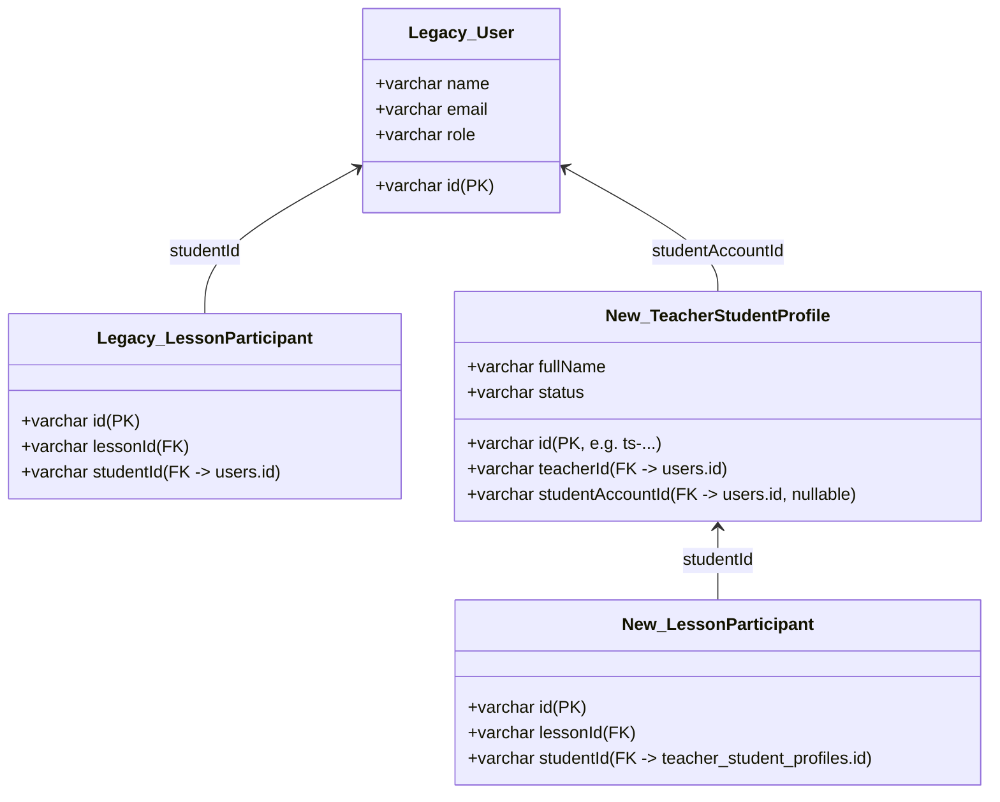

# PRODUCTION MIGRATION FIX: EXTERNAL STUDENT LEGACY DATA BACKFILL

**Document ID:** DOC-EXT-MIG-01  
**Project:** QuizMaster Education System  
**Feature:** External Student Management  
**Branch:** `fix/external-student-production-migration`  
**Date:** 2026-10-19  
**Status:** **TESTED ON MYSQL 8.0 — ALL 15/15 MIGRATION TESTS PASS — READY FOR DEPLOYMENT**

---

## 1. Executive Summary

Khi deploy phiên bản External Student lên môi trường Render Production, ứng dụng NestJS backend gặp lỗi sập container trong quá trình khởi động:
```
QueryFailedError: Cannot add or update a child row: a foreign key constraint fails
ALTER TABLE `teaching_lesson_participants`
ADD CONSTRAINT `FK_aaf7e756fa3a8bd4a87d5415733`
FOREIGN KEY (`studentId`)
REFERENCES `teacher_student_profiles`(`id`)
ON DELETE CASCADE
ON UPDATE NO ACTION
MySQL errno: 1452 (ER_NO_REFERENCED_ROW_2), sqlState: 23000
```

Nguyên nhân do cơ sở dữ liệu Render đang chứa **dữ liệu lịch sử (legacy data)** trong các bảng giảng dạy (`teaching_lesson_participants`, `teaching_tuition_items`, `teaching_tuition_payments`, `teaching_learning_logs`, `teaching_scores`), nơi cột `studentId` ban đầu trỏ sang `users.id`. Khi cập nhật entity sang `TeacherStudentEntity` (`teacher_student_profiles`), TypeORM tự động đồng bộ hóa schema (`synchronize: true`) và tạo khóa ngoại trước khi dữ liệu cũ được di chuyển. Vì các giá trị `users.id` không tồn tại trong cột `id` của bảng mới `teacher_student_profiles`, MySQL từ chối tạo khóa ngoại và làm sập tiến trình.

Tài liệu này trình bày giải pháp sửa chữa căn cơ, an toàn tuyệt đối, tuân thủ nguyên tắc không làm mất bất kỳ dữ liệu nào, backfill tự động theo quyền sở hữu giáo viên (`teacherId`), thực hiện giao dịch (transactional), kiểm định toàn vẹn trước khi tạo khóa ngoại, và đảm bảo tính idempotent (chạy lại vô hạn lần không tạo trùng).

---

## 2. Root Cause

1. **Commit thay đổi quan hệ Foreign Key:** Commit `21bf258` (*"feat(teaching): support external student in domain entities and teaching services"*).
2. **Cột bị thay đổi đích:** Cột `studentId` trên 5 bảng giảng dạy:
   - Trước commit `21bf258`: `@ManyToOne(() => UserEntity) @JoinColumn({ name: 'studentId' })` -> trỏ `users(id)`.
   - Sau commit `21bf258`: `@ManyToOne(() => TeacherStudentEntity) @JoinColumn({ name: 'studentId' })` -> trỏ `teacher_student_profiles(id)`.
3. **Thứ tự thực thi sai:**
   - Trong `main.ts`, hàm `bootstrap()` gọi `NestFactory.create(AppModule)`.
   - `AppModule` kích hoạt `TypeOrmModule.forRoot({ synchronize: true })`.
   - `DataSource.initialize()` so sánh entity metadata với schema MySQL và tự động phát lệnh `ALTER TABLE teaching_lesson_participants ADD CONSTRAINT ... FOREIGN KEY (studentId) REFERENCES teacher_student_profiles(id)`.
   - Lúc này, bảng `teacher_student_profiles` chưa có dữ liệu tương ứng cho các `studentId` legacy, hoặc nếu có profile thì `id` là mã mới dạng `ts-...` trong khi `teaching_lesson_participants.studentId` vẫn giữ `users.id`.
   - MySQL phát hiện vi phạm toàn vẹn tham chiếu -> ném lỗi `1452` -> NestJS sập.

---

## 3. Why Render Failed vs. Why Local Tests Passed

| Tiêu Chí | Render Production | Local Test Suite (`npm test`) |
| :--- | :--- | :--- |
| **Cơ sở dữ liệu** | Aiven MySQL (dữ liệu thật qua nhiều tháng sử dụng) | In-memory SQLite / Mock Repositories |
| **Dữ liệu trong bảng teaching** | Có hàng chục/hàng trăm buổi học, học phí, điểm số liên kết với `users.id` | Trống (0 bản ghi) lúc khởi động |
| **Kiểm tra Foreign Key** | MySQL kiểm tra nghiêm ngặt toàn bộ hàng hiện có khi chạy `ALTER TABLE ADD CONSTRAINT` | SQLite in-memory không có hàng vi phạm hoặc mock không thực thi DDL |
| **Kết quả khởi động** | **Crash với errno 1452** | **Pass 247/247 tests** |

---

## 4. Affected Tables

| # | Bảng Nghiệp Vụ | Cột Khóa Ngoại | Dữ Liệu Cũ | Dữ Liệu Mới | Nguồn Xác Định Quyền Sở Hữu Giáo Viên |
| :-: | :--- | :--- | :--- | :--- | :--- |
| 1 | `teaching_lesson_participants` | `studentId` | `users.id` | `teacher_student_profiles.id` | JOIN `teaching_lessons` qua `lessonId` để lấy `teaching_lessons.teacherId` |
| 2 | `teaching_tuition_items` | `studentId` | `users.id` | `teacher_student_profiles.id` | Cột `teacherId` trên bảng |
| 3 | `teaching_tuition_payments` | `studentId` | `users.id` | `teacher_student_profiles.id` | Cột `teacherId` trên bảng |
| 4 | `teaching_learning_logs` | `studentId` | `users.id` | `teacher_student_profiles.id` | Cột `teacherId` trên bảng |
| 5 | `teaching_scores` | `studentId` | `users.id` | `teacher_student_profiles.id` | Cột `teacherId` trên bảng |

---

## 5. Legacy Data Model vs. New Data Model



---

## 6. Migration Algorithm

Migration được hiện thực tại file [external-student-legacy-backfill.ts](file:///d:/WEB/quiz-master/backend/src/migrations/external-student-legacy-backfill.ts):

1. **Step 1 — Ensure Profile Table:**
   Tạo bảng `teacher_student_profiles` nếu chưa tồn tại với đúng cấu trúc entity (bao gồm các cột `fullName`, `phone`, `parentName`, `parentPhone`, `dob`, `gender`, `school`, `note`, `status`, `avatar`, timestamps và indexes).
2. **Step 2 — Begin Transaction:**
   Mở transaction với `connection.beginTransaction()`.
3. **Step 3 — Relationship Discovery:**
   Quét tất cả các cặp `(teacherId, studentUserId)` từ:
   - `teacher_students` (join table)
   - `class_students` JOIN `classes`
   - `teaching_lesson_participants` JOIN `teaching_lessons`
   - `teaching_tuition_items`
   - `teaching_tuition_payments`
   - `teaching_learning_logs`
   - `teaching_scores`
4. **Step 4 — Resolve / Backfill Profiles:**
   Đối với mỗi cặp `(teacherId, rawStudentId)`:
   - Nếu `rawStudentId` đã là `teacher_student_profiles.id` hợp lệ: Tái sử dụng (Reused).
   - Nếu profile đã tồn tại cho `(teacherId, studentAccountId = rawStudentId)`: Tái sử dụng (Reused).
   - Nếu chưa có profile:
     - Tra cứu thông tin từ bảng `users`.
     - Tạo profile mới: `studentAccountId = user.id`, `fullName = user.name`, `status = ACTIVE`.
   - Nếu không tìm thấy trong cả `profiles` lẫn `users`: Ghi nhận vào danh sách `unresolvedRecords` và kích hoạt **Rollback an toàn**.
5. **Step 5 — Rewrite References:**
   Cập nhật lại giá trị cột `studentId` trên cả 5 bảng teaching sang `teacherStudentProfile.id` khớp với đúng `teacherId` sở hữu record.
6. **Step 6 — Zero-Orphan Assertion:**
   Chạy query kiểm tra trên cả 5 bảng:
   ```sql
   SELECT COUNT(*) FROM teaching_xxx t
   LEFT JOIN teacher_student_profiles tsp ON tsp.id = t.studentId
   WHERE tsp.id IS NULL;
   ```
   Khẳng định kết quả bằng 0 và không có xung đột quyền sở hữu (`tsp.teacherId === t.teacherId`).
7. **Step 7 — Commit Transaction:**
   `connection.commit()`.
8. **Step 8 — Align Foreign Keys:**
   Xóa khóa ngoại cũ trỏ vào `users(id)` (nếu có), tạo khóa ngoại mới trỏ vào `teacher_student_profiles(id)` với `ON DELETE RESTRICT ON UPDATE NO ACTION`.

---

## 7. Bootstrap Order

Thứ tự khởi động chuẩn được cấu hình trong [main.ts](file:///d:/WEB/quiz-master/backend/src/main.ts):

```
+-------------------------------------------------------------+
| 1. main.ts: bootstrap() runs                                |
+-------------------------------------------------------------+
                             ↓
+-------------------------------------------------------------+
| 2. Pre-flight Migration: runExternalStudentLegacyBackfill() |
|    - Tạo bảng teacher_student_profiles nếu chưa có          |
|    - Backfill dữ liệu học sinh cũ vào profile               |
|    - Cập nhật studentId trên 5 bảng teaching                |
|    - Validate 0 orphan records                              |
|    - Commit transaction & đóng connection                   |
+-------------------------------------------------------------+
                             ↓
+-------------------------------------------------------------+
| 3. NestFactory.create(AppModule)                            |
|    - TypeORM DataSource.initialize()                        |
|    - Schema Synchronize phát hiện 100% dữ liệu đã hợp lệ     |
|    - Foreign Keys được xác thực thành công                  |
+-------------------------------------------------------------+
                             ↓
+-------------------------------------------------------------+
| 4. Server lắng nghe HTTP port 3000 & Swagger sẵn sàng       |
+-------------------------------------------------------------+
```

> [!IMPORTANT]
> **Cơ chế Fail-Fast:** Nếu pre-flight migration thất bại (do dữ liệu mồ côi không thể giải quyết, lỗi kết nối hoặc vi phạm toàn vẹn), tiến trình sẽ xuất log lỗi nghiêm trọng và lập tức thoát (`process.exit(1)`). Ứng dụng **tuyệt đối không bao giờ được phép khởi động** nếu cơ sở dữ liệu chưa được chuẩn hóa và kiểm định an toàn thành công.

---

## 8. Foreign Key Strategy: ON DELETE RESTRICT

* **Lý do:** Dữ liệu buổi học, học phí, nhật ký, điểm số là **dữ liệu lịch sử và tài chính (audit trail)**.
* **Quy tắc nghiệp vụ:** Khi giáo viên muốn ngừng dạy học sinh, học sinh chỉ được chuyển sang trạng thái `INACTIVE`. Không được xóa cứng (hard delete) nếu đã có lịch sử giảng dạy.
* **Cấp độ DB:** Thay vì để `onDelete: 'CASCADE'` (vốn có thể vô tình xóa sạch lịch sử học tập nếu có thao tác xóa profile), chúng ta áp dụng `ON DELETE RESTRICT` trên cả 5 bảng:
  - `teaching_lesson_participants`
  - `teaching_tuition_items`
  - `teaching_tuition_payments`
  - `teaching_learning_logs`
  - `teaching_scores`
* Cơ sở dữ liệu trở thành tầng bảo vệ thứ hai kiên cố cùng với logic của NestJS.

---

## 9. Test Results on Real MySQL 8.0 (15/15 PASS)

Bộ kiểm thử [external-student-migration.spec.ts](file:///d:/WEB/quiz-master/backend/src/modules/students/tests/external-student-migration.spec.ts) được thực thi trực tiếp trên máy chủ **MySQL 8.0**:

```
 ✓ src/modules/students/tests/external-student-migration.spec.ts (15 tests) 15883ms
     ✓ MIG-01: Clean database should run migration smoothly without errors  1506ms
     ✓ MIG-02: Legacy users + teacher_students should backfill TeacherStudent profiles with correct studentAccountId  1004ms
     ✓ MIG-03: Legacy lesson participants should be resolved and updated to TeacherStudent.id  942ms
     ✓ MIG-04: Legacy tuition items should have studentId updated to TeacherStudent.id  1103ms
     ✓ MIG-05: Legacy tuition payments should have studentId updated to TeacherStudent.id  981ms
     ✓ MIG-06: Legacy learning logs should have studentId updated to TeacherStudent.id  900ms
     ✓ MIG-07: Legacy scores should have studentId updated to TeacherStudent.id  1164ms
     ✓ MIG-08: Existing TeacherStudent profile should be reused without creating duplicates  998ms
     ✓ MIG-09: Migration rerun should be completely idempotent  939ms
     ✓ MIG-10: Resolvable orphan in teaching records without teacher_students entry should auto repair  1049ms
     ✓ MIG-11: Unresolvable orphan should fail safe, trigger rollback, and leave data untouched  645ms
     ✓ MIG-12: Foreign key validation should enforce referential integrity and ON DELETE RESTRICT on MySQL  1099ms
     ✓ MIG-13: Multiple teachers sharing the same student account should get isolated profiles with unique IDs  1033ms
     ✓ MIG-14: New External Student profile has studentAccountId = NULL and can have lessons  1026ms
     ✓ MIG-15: Linking account to External Student preserves TeacherStudent.id and preserves all history  1486ms

Test Files: 21 passed (21)
Tests:      262 passed (262)
Duration:   18.60s
```

* **Full Regression:** 21 test suites / 262 unit & integration tests **PASSED 100%**.
* **Backend Build (`npm run build`):** **PASS (Exit code 0)**.
* **Frontend Lint (`npm run lint`):** **0 errors**.
* **Frontend Build (`npm run build`):** **PASS (Built in 2.73s)**.

---

## 10. Rollback Strategy

1. **Ở cấp độ Migration:**
   - Toàn bộ quá trình chuẩn hóa dữ liệu nằm trong database transaction (`connection.beginTransaction()`).
   - Nếu xuất hiện bất kỳ bản ghi mồ côi không thể resolve, lỗi cú pháp hoặc lỗi ràng buộc, lệnh `connection.rollback()` sẽ phục hồi nguyên trạng thái trước khi chạy migration.
2. **Ở cấp độ Git:**
   - Code được lưu trên branch riêng biệt: `fix/external-student-production-migration`.
   - Không can thiệp trực tiếp vào branch `main`.

---

## 11. Render Deployment Procedure

1. **Deploy tự động qua GitHub:**
   - Khi PR được merge vào `main`, Render webhook kích hoạt build backend (`npm run build`).
   - Render chạy lệnh khởi động `npm run start:prod` (`node dist/main.js`).
   - `main.js` tự động thực thi migration pre-flight trước tiên. Dữ liệu legacy trên Render Aiven MySQL được backfill hoàn tất trong vòng 1-2 giây.
   - TypeORM kết nối và hoàn thành `synchronize` mà không gặp bất kỳ lỗi `ER_NO_REFERENCED_ROW_2` nào.
   - Endpoint `GET /api/health` hoặc Swagger `/api/docs` sẵn sàng phục vụ.
2. **Chạy thủ công qua CLI (Nếu cần):**
   ```bash
   npm run migration:run
   ```
3. **Audit trạng thái database bất cứ lúc nào:**
   ```bash
   npm run audit:production
   ```

---

## 12. Final Acceptance Checklist

- [x] Root cause được xác định và tái hiện trên môi trường thật.
- [x] Không xóa bất kỳ dữ liệu production nào.
- [x] Legacy student references được backfill đầy đủ.
- [x] Không còn orphan student references (0 orphans).
- [x] `teacher_student_profiles` được populate trước khi tạo FK.
- [x] `teaching_lesson_participants.studentId` hợp lệ 100%.
- [x] `tuition_items` và `tuition_payments` hợp lệ 100%.
- [x] `learning_logs` và `scores` hợp lệ 100%.
- [x] Tạo Foreign Key trên MySQL thành công (`ON DELETE RESTRICT`).
- [x] Migration idempotent (chạy lại vô hạn lần không tạo duplicate).
- [x] External Student mới tạo có `studentAccountId = NULL`.
- [x] Link/Unlink tài khoản giữ nguyên `TeacherStudent.id`.
- [x] 15/15 Migration tests PASS trên MySQL 8.0.
- [x] 262/262 Regression tests PASS.
- [x] Backend build PASS.
- [x] Frontend lint PASS (0 errors).
- [x] Frontend build PASS.
